<!-- Cards are animated SVGs drawn by scripts/render_cards.py and refreshed daily by
     .github/workflows/update-profile.yml. Keep the cards in a row on one line with no spaces
     between them: spacing is baked into the SVGs. -->

 
 
 
 
 

